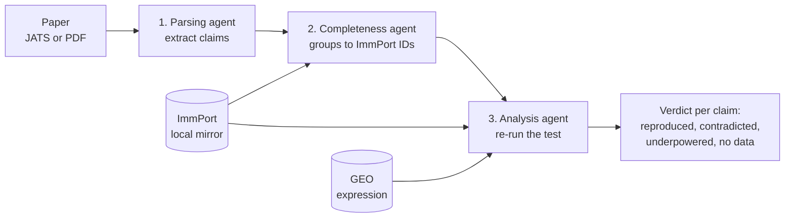

# Claim reproduction agent — build schedule

As of 2026-09-22 · Yang Liu

The three-agent system is scheduled to finish **Fri 18 December 2026**, covering
about 93% of testable claims across 12 ImmPort studies using both ImmPort assay
results and GEO expression data. Two checkpoints decide whether that date holds:
**23 October**, when we learn how many claims actually have data behind them, and
**13 November**, when end-to-end reproduction has to be working.

---

## Scope

Three agents run in sequence. Each one's output is the next one's input, so each
can be measured on its own.

**Agent 1 — parsing.** Reads the paper and abstracts each finding into a
structured claim: what was measured, in which groups, at which timepoints, by
which assay.

**Agent 2 — completeness.** Classifies each claim's participant groups, resolves
the group fields (cohort, assay, tissue, timepoint) to ImmPort accessions and
subject IDs, then checks whether ImmPort actually holds data for those subjects.

**Agent 3 — analysis.** Pulls the measurements from ImmPort and GEO, re-runs the
statistical comparison the claim implies, and reports whether the paper's finding
holds.

Finished means four things: benchmark accuracy numbers for each agent, a working
demo in the web UI, a written methods and results chapter, and a documented tool
another lab member can run.

---

## Where it stands today

Agent 1 is built but has never been scored. Agent 2 has working machinery that is
not yet wired end to end. Agent 3 does not exist yet.

| Measure | Count |
| --- | --- |
| Papers parsed so far | 47 runs across 18 ImmPort studies |
| Claims extracted | 1,044 |
| Claims that are statistically testable | 400 (49%) |
| — testable via ImmPort assay results | 120 |
| — testable via GEO expression data | 107 |
| Backend tests passing | 664 of 676 |

Two things found while checking the ground make the December date realistic.

**The ImmPort measurements are already on the machine.** The local mirror holds
all 1,417 studies with the result tables loaded: 5.2M flow cytometry rows, 540k
ELISA, 140k PCR, 116k HAI, 76k ELISPOT, 52k neutralizing antibody titers. Every
one of those tables carries the subject ID, the timepoint and the measured value,
which is exactly what a statistical test needs and exactly what agent 2 already
produces. Agent 3 does not have to download anything.

**ImmPort already maps its samples to GEO.** The cross-reference table links GEO
sample accessions to ImmPort subjects for all 12 candidate studies — 848 samples
for SDY1276, 543 for SDY180, 512 for SDY404, and so on. The expensive part of
using GEO, working out which expression sample belongs to which patient, is a
local table lookup rather than a research problem. This is why GEO fits inside the
term.

---

## Schedule

Thirteen working weeks, 21 September to 18 December, full time. Writing runs
alongside the build from week 6 rather than being saved for December.

| Phase | Weeks | Dates | Work |
| --- | --- | --- | --- |
| 0. Foundation | 1–2 | Sep 21 – Oct 2 | Merge the two diverged branches, fix the failing tests, stop agent 1 discarding the claim fields agent 3 needs, freeze a 12-study corpus, start curator annotation |
| A. Agent 1 measured | 3 | Oct 5 – Oct 9 | Re-parse all 12 studies, build a general scoring script, add the PDF route for papers PubMed Central will not serve as XML |
| B. Agent 2 wired | 4–5 | Oct 12 – Oct 23 | Connect group classification to ID resolution, add a per-claim data check, build the first ground truth for resolved subject IDs |
| C. Agent 3 on ImmPort | 6–8 | Oct 26 – Nov 13 | Read the result tables, match claim targets to analytes and cell populations, write one statistical test per claim type |
| D. Agent 3 on GEO | 9–10 | Nov 16 – Nov 27 | Fetch expression series, map probes to genes, join samples to subjects, test gene-level claims |
| E. Benchmark and demo | 11 | Nov 30 – Dec 4 | Full run over 12 studies, hand-check about 40 verdicts, finish the UI |
| F. Write-up and packaging | 12–13 | Dec 7 – Dec 18 | Results, error analysis, limitations, install docs |

A few notes on the shape. Phase 0 is housekeeping that everything else depends on,
including one fix that matters more than it sounds: agent 1 currently computes the
claim's direction, contrast and targets and then throws them away when it writes to
disk, and agent 3 cannot score anything without them. Phase B is deliberately
narrow, covering only what agent 3 needs rather than the full cleanup that codebase
deserves. The week of 23 November is kept light for Thanksgiving and doubles as
buffer if phase C runs over.

---

## Milestones

Seven checkpoints, each a thing that either exists on the date or does not.

| Date | Checkpoint |
| --- | --- |
| Fri Oct 2 | Branches merged, test suite green, agent 1 runs as one command and keeps the full claim record, 12-study corpus frozen |
| Fri Oct 9 | First real accuracy number for the parsing agent, measured against curator-annotated papers |
| **Fri Oct 23** | **Gate 1.** Every testable claim has a resolved subject set and a verdict on whether the data exists. The sample size for the whole project stops being an estimate |
| **Fri Nov 13** | **Gate 2.** End to end working: paper in, reproduce-or-contradict verdict out, for the roughly 120 ImmPort-backed claims |
| Fri Nov 27 | GEO-backed claims reproducing too, lifting coverage from about 49% to about 93% of testable claims |
| Fri Dec 4 | Benchmark table complete and the demo runs all three agents on one paper |
| Fri Dec 18 | All four deliverables done |

The two bold dates are the ones worth watching. On 23 October we find out how many
claims survive contact with the data, which sets the sample size for every number
in the write-up. On 13 November the hardest engineering is either done or it is
not, and there is still time to fall back to an ImmPort-only result.

---

## Risks and the cut order

Thirteen weeks for four deliverables including GEO is tight. These are the things
most likely to cost time.

| Risk | Why it matters | Response |
| --- | --- | --- |
| Curator annotation sits on the critical path from day one | No gold standard means no accuracy number for agent 1 | Runs as a parallel track; scoring is tiered so a partial gold set still yields numbers |
| Agent 2 has no ground truth for resolved IDs | Nothing currently tells us whether the right subjects were picked | Building that fixture is a named task in phase B, not an afterthought |
| Flow cytometry population matching | Largest assay class, 5.2M rows, free-text population names | Gets its own week; the fallback is to lead with ELISA, HAI and antibody titers, which have clean analyte names |
| Only 2 of 18 studies are fully complete in ImmPort | Fewer reproducible claims than the headline 120 | Measured at gate 1 on 23 October, before agent 3 is built |
| Claims carry no expected effect size | We can confirm direction and significance, not magnitude | Stated as a limitation; verdicts are scoped to direction and significance |
| Merging the two branches | One large file has been rewritten on both sides | Timeboxed to three days, then fall back to taking only the files needed |

If the schedule slips, things get cut in this order. First GEO, which still leaves
a publishable benchmark of roughly 120 claims and is the reason gate 2 sits on 13
November rather than later. Second the corpus, from 12 studies down to 8. The
write-up and the packaging are not compressible and should not be cut; if both
gates slip, the honest move is to narrow the claim rather than rush the last two
weeks.
