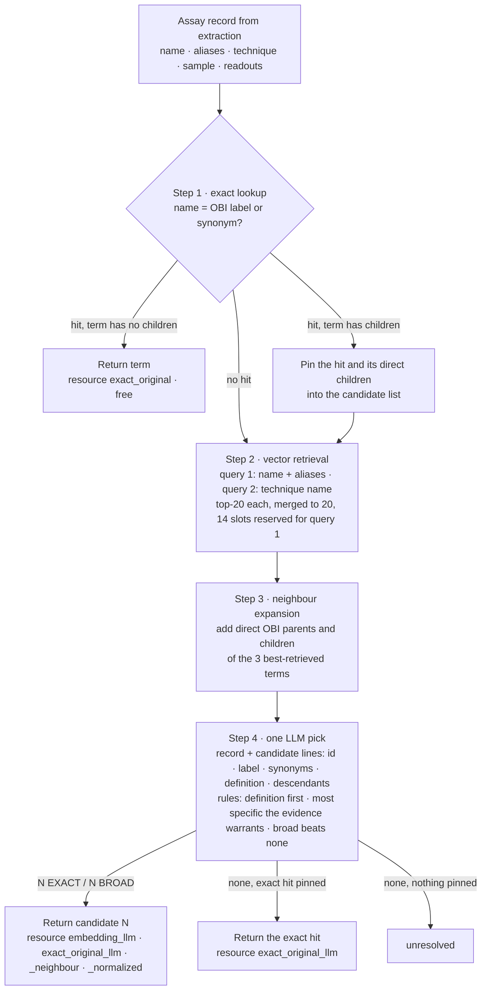

# Assay-to-OBI mapping workflow (round 4, `embedding` strategy)

*2026-10-21. The shareable version of this note is the Claude Doc "Assay-to-OBI Mapping Workflow";
this file is the repo copy. Code: `apps/api/app/agent/assay_obi_mapper.py`; prompt:
`apps/api/app/prompts/resolver_obi_assay.txt`; vocabulary: `data/OBI/obi_assay_pruned_index.json`.*

## Overview

Round 4 of the assay pipeline assigns every assay a paper reports to one term in OBI, the
Ontology for Biomedical Investigations, so that assays from different papers can be compared and
folded on a shared vocabulary. The default strategy resolves each assay name in at most three
network calls: an exact lookup against the vocabulary, a vector-similarity retrieval of the
twenty closest terms, and one LLM call that picks among them. On the 31-paper curated benchmark
it agrees with the curator's term on 134 of 149 matched assays (89.9%).

The vocabulary is the assay branch of OBI pruned to 701 generic terms: 545 analyte-specific
constructs ("ELISPOT assay measuring epitope specific IFN-gamma production by T cells") and 548
out-of-scope domain terms are removed, because they outrank the plain technique terms in
similarity search. Each term carries label, synonyms, definition, descendant count and direct
`is_a` parents.

Inputs per assay come from the extraction rounds: the paper's own name for the assay, its other
wordings and aliases, the extractor's judgement of the standard technique, the sample type and
the readouts. Only the paper's name is an exact key; everything else reaches the model as
evidence.

## Workflow

## Step by step

1. **Exact lookup (free).** The paper's own name, lowercased, is looked up against every OBI
   label and synonym; a trailing " assay" is ignored on both sides. A hit on a term with no
   children in the vocabulary is returned at once (`exact_original`). A hit on a term that has
   children ("RNA-seq", "flow cytometry") is not returned: papers name assays by the bare
   technique word, which is usually the parent term, so the hit and its direct children are
   pinned into the candidate list for step 4 to decide.
2. **Vector retrieval.** Two queries are embedded with `text-embedding-3-small` and scored by
   cosine similarity against the 701 pre-embedded terms (label, synonyms and definition):
   the paper's wording `name | alias 1 | alias 2 ...`, and the standard technique name when it
   differs. Each returns its top 20; the pools are merged into one list of 20 with 14 slots
   reserved for the paper-wording pool. There is no similarity threshold.
3. **Neighbour expansion.** For the three best-retrieved terms, their direct OBI parents and
   children are appended (children only when a term has eight or fewer), so the model makes
   the parent-versus-child choice itself.
4. **One LLM pick.** Temperature 0, fixed seed. The model sees the record and every candidate as
   one line: id, label, up to four synonyms, definition (300 characters), descendant count, and
   why it is there (similarity, exact name match, child/parent of candidate N). Rules in order
   of weight: definition over label; most specific term the evidence warrants; assay name
   outranks readouts and sample type; aliases and technique name are evidence, not overrides;
   prefer a correct broad category to none. Domain rules cover arrays, functional assays read on
   a cytometer, and multiplex bead immunoassays. Reply: `N EXACT`, `N BROAD` or `none`.
5. **Result.** Term id and label, the cosine score as `obi_confidence`, EXACT/BROAD, and a
   `resource`: `exact_original_llm` (exact hit pinned), `embedding_llm_neighbour` (reached only
   through the expansion), `embedding_llm_normalized` (retrieved only by the technique query),
   `embedding_llm` otherwise. `none` falls back to the pinned hit if there is one, else
   `unresolved`; an unreadable reply is an error so the entry can be re-run.

Every candidate list and reply is kept in the run's `assays_raw.json`.

## Worked example (SDY1260, PMID 24336226)

**"DNA microarray"**, a clean retrieval. Record: aliases "DNA microarrays", "DNA microarray
experiment"; technique "transcription profiling by array"; sample PBMC; readouts "gene
expression levels"; evidence "DNA microarray experiment was performed ... on Affymetrix human
U133 Plus 2.0 arrays". Step 1 finds no label or synonym equal to "DNA microarray". Step 2's
merged list, first five:

| rank | OBI term | similarity |
|---|---|---|
| 1 | OBI:0001463 transcription profiling by array assay | 0.829 |
| 2 | OBI:0001235 transcription profiling by tiling array assay | 0.810 |
| 3 | OBI:0001361 transcription profiling by RT-PCR assay | 0.668 |
| 4 | OBI:0001332 DNA methylation profiling by array assay | 0.661 |
| 5 | OBI:0001304 RNAi profiling by array assay | 0.651 |

Reply `1 EXACT`: the array rule prefers the array term matching what was hybridized, and
nothing says tiling array. Result OBI:0001463, `embedding_llm`, confidence 0.829; the curator's
term is the same.

**"serum bactericidal titers (SBA)"**, why the pick is an LLM call and not the top retrieved
term. Technique "serum bactericidal assay", sample serum, readouts "bactericidal titers
determined from serum dilution yielding 50% killing". Retrieval ranked a wrong term first:

| rank | OBI term | similarity |
|---|---|---|
| 1 | OBI:0002649 blood microbiology assay | 0.593 |
| 2 | OBI:0003797 bacterial neutralization assay | 0.576 |
| 3 | OBI:0003590 serum anti-cytomegalovirus antibody level assay | 0.534 |

Reply `2 EXACT`. Rank 1 is defined as detecting microorganisms in a blood specimen, which an SBA
does not measure; rank 2, "a pathogen neutralization assay measuring neutralization of
bacteria", is. The scores differ by 0.017 and carry no such information; the definition does.

## Cost and accuracy (31-paper benchmark v4, scored 2026-10-19)

| measure | value |
|---|---|
| curated assays matched to one of ours | 149 of 179 |
| same OBI term as the curator | 134 (89.9%) |
| parent or child of the curator's term | 4 |
| a different term | 6 |
| curator gave no OBI id | 5 |
| curated assays we did not find (extraction miss) | 12 |

Cost: an exact hit on a leaf term is free; every other assay costs 2 to 3 calls (one or two
embedding calls plus one chat call). Retrieval alone puts the curator's term among the 20
candidates for 91% of benchmark rows.

## Alternatives evaluated

Two tree-based strategies were compared with the stored embedding mapping on the three papers
where it disagreed most with the curator (SDY1264, SDY1373, SDY1260; 18 curated assays). See
`docs/obi_descent_vs_embedding_3papers.md`.

| strategy | how it works | same term as curator | calls |
|---|---|---|---|
| embedding (default) | retrieve 20, one pick | 11 of 18 | 41 (stored) |
| descend | walk the OBI tree from the top, one call per level | 10 of 18 | 37 |
| hybrid | the embedding pick, then one descent from it when the term has children | 11 of 18 | 11 |

The tree walk fails where OBI's `is_a` placement differs from the category a reader would enter
(serum neutralization of viral infectivity sits under analyte assay, not pathogen
neutralization); retrieval finds the term by its label regardless of branch. The hybrid fixed
one parent-for-child case and over-specified another. Only 3 corpus rows are parent-for-child
disagreements, so no descent variant can move the benchmark by more than 2 rows. `embedding`
stays the default; both alternatives remain selectable through `OBI_MAPPING_STRATEGY`.
